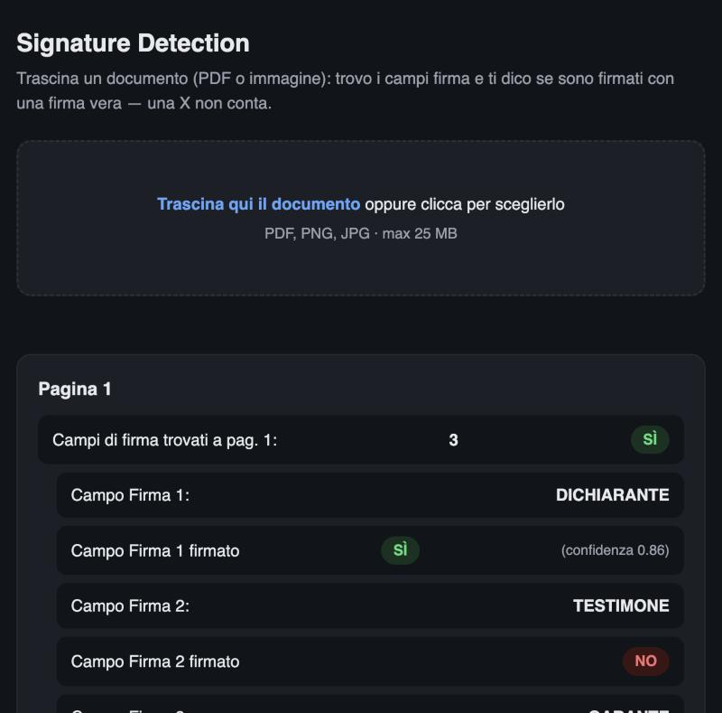

# Signature Detection

Dato un documento (PDF o immagine), trova i campi firma e dice se sono firmati
**con una firma vera**: una X, una spunta o una riga non contano.



## Come funziona

1. **Detection delle firme** — YOLO11s pre-addestrato su firme autografe
   ([StabRise/signature_detection_v0.1](https://huggingface.co/StabRise/signature_detection_v0.1),
   classe unica `signature`), eseguito in ONNX con onnxruntime su CPU.
2. **Filtro anti-X** — ogni rilevamento passa un controllo geometrico (RANSAC):
   se l'inchiostro del box è spiegabile quasi interamente da ≤3 segmenti
   rettilinei (una X, una spunta, una riga) non è una firma e viene scartato.
3. **Individuazione dei campi firma** — per i PDF: widget AcroForm di tipo firma
   se presenti, altrimenti parole-chiave nel text layer ("Firma", "Signature", …)
   su righe corte (etichette, non testo scorrevole), con una zona candidata
   attorno all'etichetta.
4. **Matching** — un campo è firmato se una firma vera ricade per almeno il 25%
   della sua area nella zona del campo. Firme fuori dai campi → `orphan_signatures`.

**Scansioni e foto** (immagini o PDF senza text layer): il testo arriva
dall'OCR — Apple Vision su macOS (ottimo anche su foto, italiano incluso),
RapidOCR (ONNX) come fallback cross-platform — e le righe di firma vengono
rilevate direttamente dai pixel (linee orizzontali continue di larghezza
tipica). Il matching delle keyword è fuzzy (Levenshtein ≤2) per tollerare gli
errori OCR, tipici quando la firma copre l'etichetta; un campo con etichetta
incerta e senza riga vale solo se risulta firmato.

## Setup

```bash
uv venv --python 3.11
source .venv/bin/activate
uv pip install -r requirements.txt
python download_models.py      # scarica i pesi ONNX da Hugging Face
python make_test_doc.py        # (opzionale) genera test_contract.pdf
python make_xmark_doc.py       # (opzionale) genera test_xmark.pdf
```

## Web app (drag & drop)

```bash
uvicorn app:app --port 8000
```

Apri http://localhost:8000, trascina un PDF o un'immagine e per ogni pagina ottieni:

* **campo di firma trovato (sì/no)**
* **campo di firma firmato all'interno (sì/no)** — con dettaglio per campo e confidenza

più la pagina annotata (verde = firmato, rosso = non firmato, arancio = segno
tipo X ignorato, blu = firma fuori campo).

API: `POST /api/analyze` (multipart, campo `file`) → JSON per pagina.

## CLI

```bash
python detect_signatures.py documento.pdf -o output --json report.json
```

Opzioni: `-m/--model` pesi ONNX alternativi, `--conf` soglia YOLO (default 0.25).

## Modelli

| Modello | File | Note |
|---|---|---|
| StabRise YOLO11s (default) | `models/StabRise/model.onnx` | il migliore testato |
| liberty666 YOLO11n | `models/liberty666/yolo11n_signature.onnx` | più piccolo |
| tech4humans YOLOv8s | — | il più scaricato su HF ma *gated*: serve `hf auth login` e accettare le condizioni sulla pagina del modello |

I pesi non sono versionati nel repo: `python download_models.py` li scarica.

## Limiti noti

- Il filtro anti-X è geometrico: nomi in stampatello molto squadrati potrebbero
  essere scartati; in quel caso abbassare `SIMPLE_MARK_THRESHOLD` in
  `detect_signatures.py`.
- Le etichette dei campi sono riconosciute in it/en/de (`FIELD_KEYWORDS`).
- Nessuna verifica di identità: il sistema dice se c'è una firma autografa,
  non di chi è.
